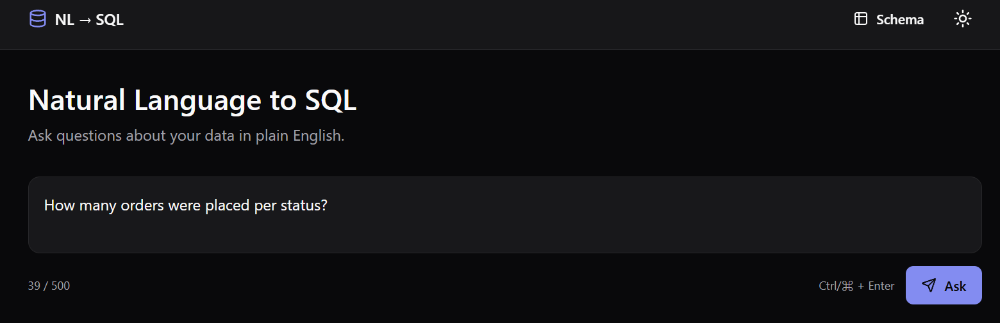
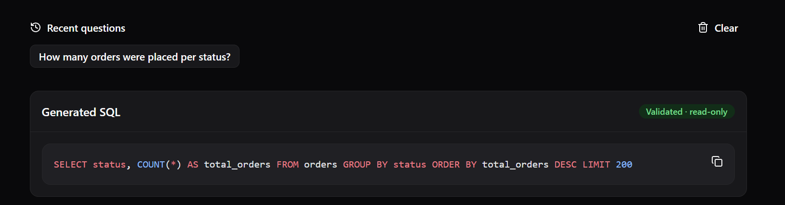
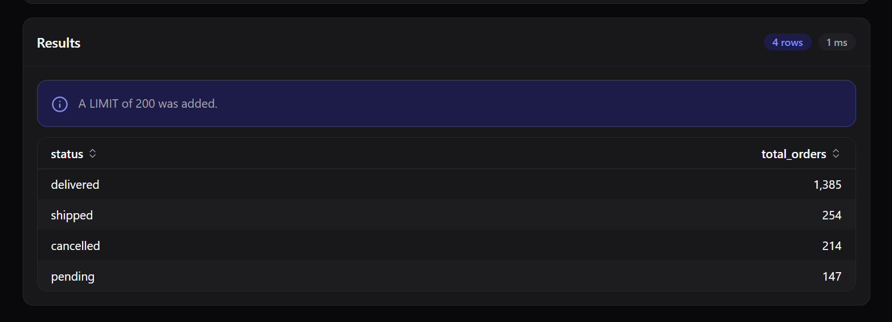

# Natural Language → SQL

Ask questions about a sample database in plain English. An LLM generates **read-only SQL**, a **validator** checks it against strict guardrails, and only then is it executed. Results are shown in a clean, accessible UI together with the SQL that produced them.

> **v1.0.0** — see [RELEASE_NOTES.md](RELEASE_NOTES.md). Showcases: **guardrails · SQL safety · schema-aware prompting**

## Screenshots







---

## Features

- **Plain-English questions** → SQL → results table
- **Schema-aware prompting**: the model only sees the tables/columns it is allowed to query
- **Multi-layer SQL safety** (see below) — nothing reaches the database unvalidated
- **Transparent**: every answer shows the generated SQL, the validation verdict, and execution time
- **Self-repair**: if validation or execution fails, the error is fed back to the model once for a corrected query
- **Polished UI**: responsive, dark/light themes, keyboard accessible, loading/empty/error states
- **Example questions** to get started in one click
- **Friendly errors**: a blocked query explains *which rule* it hit; rate-limit, network and AI-outage errors offer a retry
- **Schema browser** and **recent-question history** (kept in your browser, re-open without re-running the AI)
- **Fast repeats**: identical questions are answered from an in-memory LRU cache; per-step timings (LLM / validation / execution) are logged

## How it works

```
Question ──► Prompt builder (schema + rules) ──► LLM ──► SQL
                                                          │
                                         ┌────────────────▼───────────────┐
                                         │ Validator (AST-based, sqlglot) │
                                         └────────────────┬───────────────┘
                                      rejected ◄──────────┤──────────► approved
                               (reason shown / 1 retry)                  │
                                                          ┌──────────────▼─────────────┐
                                                          │ Read-only DB connection,   │
                                                          │ timeout, row limit         │
                                                          └──────────────┬─────────────┘
                                                                         ▼
                                                             Results + SQL + metadata
```

## SQL safety guardrails (defense in depth)

| Layer | Protection |
|-------|-----------|
| Prompt | Model told: SELECT only, use only listed tables/columns, always `LIMIT` |
| Parser | SQL parsed to an AST (not regex); must be exactly **one** `SELECT` statement |
| Allow-list | Only whitelisted tables/columns; no `PRAGMA`, `ATTACH`, `sqlite_master`, system functions |
| Block-list | `INSERT/UPDATE/DELETE/DROP/ALTER/CREATE/REPLACE/TRUNCATE`, multi-statements, comments |
| Limits | Auto-injected/capped `LIMIT`, max query length, execution timeout |
| Database | Connection opened **read-only** (`mode=ro`) — last line of defense even if the validator is bypassed |
| API | Input length limits, rate limiting, no raw DB errors leaked to the client |

## Tech stack

| Area | Choice | Why |
|------|--------|-----|
| Backend | Python 3.11+, FastAPI, Pydantic v2 | Typed, fast, auto-generated OpenAPI docs |
| SQL validation | `sqlglot` | Real SQL parser → AST checks, not string matching |
| Database | SQLite (sample e-commerce dataset) | Zero setup, supports read-only mode |
| LLM | Google Gemini (primary) + Groq (fallback), free tiers, behind an interface | Free, strong SQL generation; swappable |
| Frontend | React + TypeScript + Vite | Fast dev loop, type safety |
| Styling | Tailwind CSS + shadcn/ui (Radix) | Accessible primitives, consistent design tokens |
| Data fetching | TanStack Query | Caching, loading/error states |
| Tests | pytest, Vitest + Testing Library, Playwright (smoke) | |
| Tooling | ruff, mypy, ESLint, Prettier, pre-commit, GitHub Actions | |

## Project structure

```
Natural-Language-to-SQL/
├── backend/
│   ├── app/
│   │   ├── api/            # routes (thin controllers)
│   │   ├── services/       # llm, prompt_builder, sql_validator, executor, pipeline
│   │   ├── db/             # connection, schema introspection, seed
│   └── tests/
├── frontend/
│   └── src/
│       ├── components/     # ui/ (primitives) + feature components
│       ├── hooks/          # useAskQuestion, useTheme, ...
│       ├── lib/            # api client, utils
│       └── pages/
├── data/                   # sample SQLite DB (generated by the seed script)
├── docs/                   # ARCHITECTURE.md, GUARDRAILS.md, screenshots
├── Dockerfile · docker-compose.yml · render.yaml
├── DEVELOPMENT_PLAN.md
└── README.md
```

## Getting started

### Prerequisites
- Python 3.11+, Node 20+
- A free Gemini API key (and optionally a Groq key)

### Setup

```bash
# 1. Backend
cd backend
python -m venv .venv && .venv\Scripts\activate    # macOS/Linux: source .venv/bin/activate
pip install -e ".[dev]"
cp ../.env.example ../.env                               # edit .env: add GEMINI_API_KEY (and GROQ_API_KEY)
python -m app.db.seed                              # builds the sample database
uvicorn app.main:app --reload                      # http://localhost:8000/docs (API docs)

# 2. Frontend (new terminal)
cd frontend
npm install
npm run dev                                        # http://localhost:5173
```

### Run with Docker

```bash
cp .env.example .env      # add GEMINI_API_KEY
docker compose up --build # http://localhost:8000 (UI and API on one origin)
```

The image builds the UI, seeds the sample database and serves everything from one container.

### Deploy to Render

1. Push the repo to GitHub, then in Render choose **New + → Blueprint** and select it (uses `render.yaml`), or create a **Web Service** with the Docker runtime.
2. Set `GEMINI_API_KEY` (and/or `GROQ_API_KEY`) in the Render dashboard. Never commit keys. `render.yaml` already sets `ENVIRONMENT=production` (startup fails without the key, `/docs` is off) and the health check to `/api/health`.
3. Run a **single instance** (rate limiter, daily cap and cache are in-memory). The container runs uvicorn with `--proxy-headers`, so the rate limit applies per real client, not per Render proxy.
4. Optional: add an UptimeRobot (or similar) check on `https://<your-app>/api/health`.
5. **Rotate a key:** create a new key at the provider, update the env var in the Render dashboard (Render redeploys), then revoke the old key.
6. **Roll back:** Render dashboard → Events/Deploys → *Rollback* to the previous deploy.

Note: questions you type are sent to the configured LLM provider.

### Environment variables

| Variable | Default | Description |
|----------|---------|-------------|
| `GEMINI_API_KEY` | — | Required (primary provider) |
| `GROQ_API_KEY` | — | Optional fallback provider (typically much faster than Gemini) |
| `LLM_PROVIDER` | `gemini` | `gemini` or `groq` |
| `GEMINI_MODEL` / `GROQ_MODEL` | see `.env.example` | Models used for SQL generation. Groq retires models; if you get a 404 / `LLM_UNAVAILABLE`, pick a current one from Groq's `/models` list |
| `GEMINI_REASONING_EFFORT` | `low` | `low` / `medium` / `high`. Lower = faster Gemini answers (sent to Gemini only) |
| `LLM_MAX_TOKENS` | `1024` | Reply cap; includes reasoning tokens, so keep headroom (raise if replies come back empty) |
| `ANSWER_CACHE_SIZE` | `128` | LRU cache of answers for repeated questions; `0` disables |
| `DATABASE_PATH` | `data/ecommerce.db` | SQLite file (opened read-only) |
| `MAX_ROWS` | `200` | Hard cap on returned rows |
| `QUERY_TIMEOUT_SECONDS` | `5` | Execution timeout |
| `MAX_QUESTION_LENGTH` | `500` | Longest accepted question |
| `RATE_LIMIT_PER_MINUTE` | `20` | Per-client requests/minute on `/api/ask` (`429` + `Retry-After` when exceeded); `0` disables |
| `ENVIRONMENT` | `development` | `production` fails at startup if the chosen provider's key is missing and disables `/docs`, `/redoc`, `/openapi.json` |
| `DAILY_LLM_CALL_LIMIT` | `500` | Global LLM calls per UTC day (cached answers are free); then `503 DAILY_LIMIT_REACHED`. `0` disables |
| `STATIC_DIR` | — | Built frontend to serve at `/` (set automatically in the Docker image) |

## API

`POST /api/ask`
```json
{ "question": "Top 5 customers by total spend in 2024" }
```
Response:
```json
{
  "request_id": "c3035c2fbc6b",
  "question": "Top 5 customers by total spend in 2024",
  "sql": "SELECT ... LIMIT 5",
  "columns": ["customer", "total_spend"],
  "rows": [["Ada", 1234.5]],
  "row_count": 5,
  "truncated": false,
  "elapsed_ms": 42,
  "warnings": [],
  "repaired": false
}
```
Rejected queries return `422` with `{ "error": { "code": "SQL_REJECTED", "message": "...", "rule": "forbidden_operation", "request_id": "..." } }`.

Exceeding the rate limit returns `429` with code `RATE_LIMITED`. All responses carry security headers (CSP, `nosniff`, `X-Frame-Options: DENY`, ...).

`GET /api/schema` — tables/columns exposed to the model · `GET /api/health` (checks the database opens; `503` if not)

## Testing

```bash
cd backend && pytest -q          # includes an adversarial SQL-injection suite
cd frontend && npm test         # unit/component tests + axe accessibility checks
cd frontend && npm run e2e    # Playwright smoke tests (one-time: npx playwright install chromium)

# Prompt evaluation: 26 golden questions through the live LLM (needs an API key in .env)
cd backend && python -m app.evals.run_golden   # prints pass rate; exit 1 if below 85%
```

## Example questions

- "How many orders were placed each month in 2024?"
- "Which product categories generate the most revenue?"
- "List customers who have never placed an order"
- Try the guardrails: "Delete all customers" → rejected with an explanation

## Docs

- [Architecture](docs/ARCHITECTURE.md)
- [Guardrails → the tests that prove them](docs/GUARDRAILS.md)

## Roadmap

Server-side query history · CSV export · multiple databases (e.g. hosted Postgres such as Neon) · query explanation · streaming responses

## License

MIT
